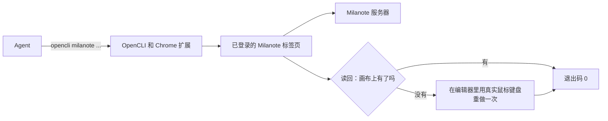

# milanote-skill

让 AI Agent 读写你在 Chrome 里已登录的 Milanote 画板：建便签和待办、读内容、挪位置，不用交出密码。

<p align="center">
  
</p>

## 实际效果


在一块新建的空画板「测试」上，对 Claude Code 说：

```text
用 milanote 技能，在「测试」画板里创建四张便签，正文分别是：买颜料、约摄影师、选配色、交稿。
```

它加载技能，先用 `whoami` 和 `boards` 找到这块画板的 id，再运行四次 `create --type note`。四条命令退出码都是 0，没有触发编辑器重做。用 `opencli milanote board <画板id>` 读回，四张便签都在画布上：

| 正文 | 类型 | x | y |
|---|---|---|---|
| 买颜料 | CARD | 0 | 4 |
| 约摄影师 | CARD | 22 | 4 |
| 选配色 | CARD | 44 | 4 |
| 交稿 | CARD | 66 | 4 |

2026-10-20 在 Windows 11、OpenCLI 2.0.1 上运行；元素 id 已从表中省略。

## 状态与限制

- **状态**：非官方项目，与 Milanote 公司无关。它靠 Milanote 网页自己用的、未公开的内部接口，接口变动时命令可能失效。2026-10-16 起开发，尚无 release。使用前请自己看一眼 Milanote 的服务条款。
- **适用**：已实测 Claude Code（Windows 11）：OpenCLI 1.8.8 上逐类验证过全部元素，2.0.1 上验证过读画板和建便签。其他 Agent、macOS、Linux 未测试。需要桌面版 Chrome，装好 OpenCLI 扩展，并在里面登录了 Milanote。
- **写入可能失败**：部分画板会拒收命令写入，报 `did not persist` 或 `did not delete`；共享画板和主画板下的个别画板都出现过，原因未查明，见 [`notes.md`](./opencli/sites/milanote/notes.md)。默认会自动改用编辑器里的真实鼠标键盘输入重做，但只覆盖便签的新建、改字、同画板内移动和删除；分栏、画板、链接、连线要手工做。重做时 Chrome 窗口不能最小化，一张便签约 20 到 40 秒。
- **数据和权限**：不读取 cookie 和密码，用的是 Chrome 里已登录的会话；权限令牌只放在内存里，分享链接不写进文件。命令只访问 `app.milanote.com`、`upload.milanote.com` 和上传用的预签名存储地址；本地只读你用 `upload --file` 指定的文件。Agent 读到的画板内容会进入你所用模型的上下文。仓库里没有账号，每个人用自己已登录的 Milanote。
- **不适合**：没有桌面版 Chrome 的环境；不能容忍接口变动的生产流程。

## 安装

三步：装 OpenCLI 和它的 Chrome 扩展并登录 Milanote；运行安装脚本；新开 Agent 会话，说一句话。装的是两样东西：技能 `milanote`（给 Agent 读的使用说明）和 OpenCLI 适配器（`opencli milanote` 命令）。

**前置条件**（本仓库不包含它们）：

- [OpenCLI](https://github.com/jackwener/opencli)，需要 Node.js 20.18.1 或更高：`npm install -g @jackwener/opencli@1.8.8`。1.8.8 上验证过全部命令；npm 上最新的 2.0.1 验证过读画板和建便签，其余命令未测。
- Chrome 里的 [OpenCLI 扩展](https://chromewebstore.google.com/detail/opencli/ildkmabpimmkaediidaifkhjpohdnifk)；运行 `opencli doctor` 确认已连接。
- 在装了扩展的同一个 Chrome 里登录 [Milanote](https://app.milanote.com/)。

**推荐**：把这句话发给你的 Agent，它会按 [`docs/install.md`](./docs/install.md) 装好并验证：

```text
帮我安装 milanote-skill：https://raw.githubusercontent.com/RZX00/milanote-skill/main/docs/install.md
```

自己装：

```bash
# macOS / Linux / Git Bash
curl -fsSL https://raw.githubusercontent.com/RZX00/milanote-skill/main/install.sh | bash
```

```powershell
# Windows PowerShell
irm https://raw.githubusercontent.com/RZX00/milanote-skill/main/install.ps1 | iex
```

脚本不到 60 行，可以先打开看一遍。它往 Cursor、Claude Code、Codex 和通用 `.agents` 四个技能目录，以及 `~/.opencli/` 写文件，同名旧目录会先删掉再复制；想先看结果，可克隆仓库后运行 `HOME=<临时目录> bash install.sh`。`install.sh` 克隆后在本地运行的模式，在 Windows 的 Git Bash 里、用临时 `HOME` 跑通过；`curl ... | bash` 的下载这一步、`install.ps1`、macOS、Linux 没有实测。

装好后验证（不打开 Chrome，应列出 `whoami`、`boards`、`create` 等命令）：

```bash
opencli milanote types -f yaml
```

<details>
<summary>Claude Code 插件方式（未实测）</summary>

```text
/plugin marketplace add RZX00/milanote-skill
/plugin install milanote@milanote-skill
```

插件只带技能说明，不带适配器；仍要运行上面的安装脚本，或把 `opencli/clis/milanote/` 复制到 `~/.opencli/clis/milanote/`。`claude plugin validate` 对市场清单 `marketplace.json` 只给出 1 条警告，没有报错（2026-10-20）；插件本身的安装没有试过。

</details>

## 第一次使用

装好后新开一个 Agent 会话，先做一件只读的事：

```text
用 milanote 技能，告诉我现在登录的是哪个 Milanote 账号，主画板下有哪些画板。
```

你会得到：Agent 先做环境自检（`scripts/preflight.sh`；Windows 上用 `opencli milanote types`），再运行 `opencli milanote whoami` 和 `boards`，回报账号名、主画板 id（`homeBoardId`）和每块画板的 id、标题。

再试一次写入。先在 Milanote 里新建一块空的测试画板，然后说：

```text
用 milanote 技能，在「测试」画板里创建四张便签，正文分别是：买颜料、约摄影师、选配色、交稿。
```

你会得到：画板上多出四张便签；命令为每张返回 `id` 和坐标 `x`、`y`（便签的 `openUrl` 为空）。退出码为 0，才表示画布上真有了它；报 `did not persist` 时见上面的「状态与限制」。

<details>
<summary>不经过 Agent，直接用命令</summary>

`<画板id>` 来自 `whoami` 的 `homeBoardId`，或 `boards` 的输出。

```bash
opencli milanote boards -f yaml
opencli milanote board <画板id> -f yaml
opencli milanote create --type note --text "记下这一点" --parent <画板id> -f yaml
```

Windows PowerShell 里，先运行 `$env:OPENCLI_BROWSER_COMMAND_TIMEOUT='120'`。

</details>

## 为什么用它

Milanote 的画板是自由画布，元素按 x、y 坐标摆放，没有行和列。通用的浏览器自动化要自己从截图或页面结构里找位置，写进去没有也得自己核对。本技能让 Agent 用命令读到每个元素的 id、类型、文字和坐标；写入后读回核对，Milanote 丢弃了写入，就自动在编辑器里用真实鼠标键盘重做一次。登录用你 Chrome 里已有的会话，Agent 不碰密码。

## 能做什么，怎么工作

能创建和读写的元素：画板、分栏、便签、链接、待办清单和待办项、色块、图片（URL 或本地文件，最大 4 MB）、连线、草图、批注、文档、表格、别名、评论。2026-10-16 在一块已登录的画板上逐类验证过，记录见 [`notes.md`](./opencli/sites/milanote/notes.md)。

| 做什么 | 命令 |
|---|---|
| 读 | `whoami`、`boards`、`board <id>`、`get <id>`、`tree --id <id>`、`search --query`、`comments <id>` |
| 创建 | `create --type <类型>`、`draw`（带第一笔的草图）、`comment`、`upload`、`duplicate`、`cell`（表格单元格） |
| 修改 | `update <id>`、`move <id>`、`delete <id> --yes true` |
| 登录 | `login` |

完整命令表和用法在 [`skills/milanote/SKILL.md`](./skills/milanote/SKILL.md)；以 `opencli milanote --help` 为准。



`create`、`update`、`move`、`delete` 的 `--via auto|api|ui` 选择写入方式：`auto`（默认）先发命令，读回发现没存上再改用编辑器；`api` 只发命令；`ui` 只用编辑器。

## 配置、限制和常见问题

- 环境变量 `OPENCLI_BROWSER_COMMAND_TIMEOUT`：只做命令写入时至少 120；可能走编辑器写入时设 300。`MILANOTE_UI_DEBUG=1` 把编辑器写入的每一步和耗时打到标准错误。
- 只靠分享链接进入的画板：每条命令加 `--link "<分享链接>"`。分享链接等于这块画板的访问权限，不要贴进对话或提交。这条路径只在画板主人的账号上测过，只有链接的账号还没测。
- 不删除、不复制主画板。文档标题只能在创建时设定，之后改的是正文。草图的第一笔必须在创建时写上。`duplicate` 是内容副本，不会跟着原件更新。到期日、反应、指派、分享和回收站恢复没有命令。

<details>
<summary>常见报错</summary>

| 报错 | 做法 |
|---|---|
| `the Milanote tab is hidden` | 还原被最小化的 OpenCLI Chrome 窗口，重试 |
| `did not persist`、`did not delete`（已自动回退仍报） | 见 SKILL.md 的「写不进时：改走界面」；先 `board <画板id>` 读回，别重发同一条创建 |
| `<id> is not accessible` | 这块画板只能凭分享链接进，加 `--link` |
| 扩展未连接 | 运行 `opencli doctor`；仍失败就在装了扩展的 Chrome 配置里打开 Milanote |
| `SESSION_BUSY` | 运行 `opencli daemon restart`，等 `opencli doctor` 正常再重试 |

</details>

<details>
<summary>已知问题（2026-10-20）</summary>

- `skills/milanote/scripts/preflight.sh` 和 SKILL.md「开始」一节把 `$HOME/.hermes/node/bin` 写死进 PATH，那是作者自己的 Node 安装位置。`opencli` 已在 PATH 上时没有影响；不在时，报错里提示的路径对别人没用。
- 仓库没有 `package.json`，在检出目录里运行 `node --test` 找不到 `@jackwener/opencli`。测试要在装好的 `~/.opencli/clis/milanote/` 里跑：`node --test codec.test.js uiplan.test.js`，实测 26 项通过。
- 安装脚本总是写四个宿主的目录，并拉取 `main` 分支的最新内容，没有固定版本。
- `.claude-plugin/marketplace.json` 的 `metadata.repository` 不是 Claude Code 认识的字段，`claude plugin validate` 报 1 条警告，加载时被忽略。
- `docs/install.md` 的原始链接要等本文件合并到 `main` 后才可用。

</details>

## 许可证

[MIT](./LICENSE) © rzx00。适配器运行在 [OpenCLI](https://github.com/jackwener/opencli) 之上，它是 jackwener 的开源项目（Apache-2.0）。
